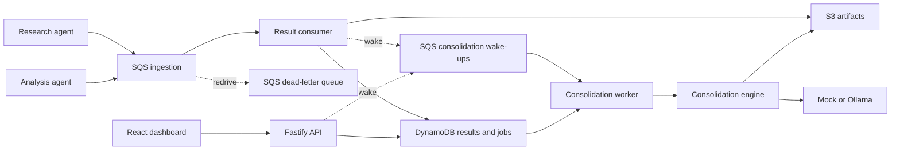

# Local-first architecture

Agents are independent publishers. They accept configuration and run on their own schedule. The consolidation worker schedules synthesis of persisted evidence and has no agent execution capability. The engine reads through repository ports and receives a model provider through its interface. Both entry paths use the same selection, snapshot, reference validation, and report persistence.

DynamoDB is the authority for accepted result revisions, jobs, leases, report metadata, and change signals. S3 holds larger evidence, exact normalized input snapshots, and immutable report bodies. SQS delivery can repeat. Conditional writes and the event receipt make retries safe. The report transaction checks the current project lease before publishing, and a committed run can be recovered after lost acknowledgement.

The browser reads the project-authorized API and refreshes from SSE invalidations or polling. Structured report content is rendered as text. Mock reports carry simulated provenance. The API validates requests and responses, the provider validates model output and source membership, and the engine checks references again before publication.

## Security and operating boundaries

- Keep Floci and Ollama on loopback or a private Compose network. Floci's dummy credentials are for development only. Use API bearer tokens with explicit project grants and TLS at the ingress when exposing the API. Development authentication requires explicit enablement and loopback checks and is rejected in production.
- Agent evidence is untrusted. The Ollama adapter sends source content as data, disables redirects, and provides no tools. External source URLs are displayed as text. Model references are validated against supplied IDs, which establishes traceability rather than factual correctness.
- Enforce upload, artifact, model-input, HTTP-response, and stream-frame bounds at their boundaries. Oversized model inputs fail explicitly. Job error responses expose error codes without model text or internal transport details.
- Project-level leases serialize overlapping jobs. Scheduler discovery scans, synchronous normalization, and SSE version polling target modest local workloads. The SDK and Terraform checks validate Floci behavior. Real AWS IAM, deployment, and load characteristics remain separate work.

See the [architecture decisions](decisions/) for the tradeoffs recorded by phase.
